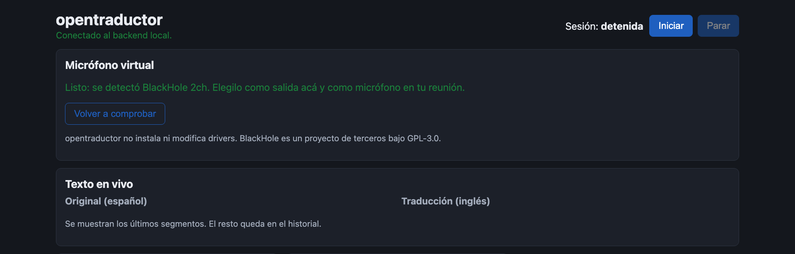

# opentraductor

[](https://github.com/gastonzarate/opentraductor/actions/workflows/ci.yml)
[](LICENSE)

Local speech-to-speech translation from Argentine Spanish to US English for macOS on Apple Silicon.
You speak Spanish, and your Mac says it in English a moment later. Nothing leaves your machine: speech recognition, translation and voice synthesis all run on-device.

It is built for meetings: the English voice goes to a virtual microphone, so Google Meet or Discord can pick it up.

> **Status: experimental.** It works on the author's Mac, and the numbers below are honest but small samples. There is no 300 ms promise: today the delay between the end of your sentence and the first English audio is about 0.57 seconds (median). With the Mac busy, peaks reach about 1 second.
> Spanish version: [README.es.md](README.es.md).



*The local interface in the browser, before starting a session. While it runs, the live-text panel shows the Spanish and the English side by side.*

## What it does

```
mic ──► VAD (Silero) ──► ASR (Parakeet or Moonshine) ──► translation (Qwen3 or Marian) ──► TTS (Kokoro) ──► virtual mic
```

- **100 % local.** After the one-time model download, the runtime forces offline mode. No telemetry, no accounts, no CDN.
- **No audio is stored.** Only text (original and translation) goes to a small local SQLite history you can export or delete from the UI.
- **Local web UI** on `127.0.0.1` only, with a per-run token and `Host`/`Origin` checks.
- Pick your microphone, your output (for meetings, a virtual microphone) and an optional local monitor.

## Requirements

- A Mac with **Apple Silicon**. Tested on an M5 Pro, 48 GB, macOS 26. Moonshine needs macOS 15 or later.
- Python 3.12 and [uv](https://docs.astral.sh/uv/).
- Disk: about 3 GB for the base models, more for Qwen (the 4B model needs about 16 GB of RAM or more; below that the code picks Qwen3-1.7B).
- Optional, for meetings: [BlackHole 2ch](https://github.com/ExistentialAudio/BlackHole). It is GPL-3.0 and it is **not** included. You install it yourself.

## Install

```bash
git clone https://github.com/gastonzarate/opentraductor.git
cd opentraductor

uv sync --extra runtime
uv run --extra runtime python -m runtime.setup     # downloads the models. Only step that uses the network.
uv run --extra runtime python -m runtime check     # verifies everything is on disk
uv run --extra runtime python -m runtime run       # opens http://127.0.0.1:8877/
```

Always pass `--extra runtime`; without it `uv` removes the runtime dependencies.

This default profile uses Parakeet (ASR), Marian (translation) and Kokoro (voice).

### Faster profile: Moonshine + Qwen3

This is the profile behind the latency numbers below. It needs the Moonshine extra and a Qwen model on disk.

```bash
uv sync --extra runtime --extra moonshine
python3 scripts/setup_moonshine.py                  # Moonshine Spanish streaming weights, hashes verified

# Qwen weights are not downloaded by `runtime.setup`. Put them anywhere and point to them:
uv run --extra runtime hf download mlx-community/Qwen3-4B-Instruct-2507-4bit --local-dir ~/qwen3-4b
export OPENTRADUCTOR_QWEN_DIR=~/qwen3-4b

uv run --extra runtime --extra moonshine python -m runtime run --asr-backend moonshine-tiny --mt-engine qwen
```

Keep both extras in every `uv` command of this profile, or `uv` removes the Moonshine package.

### Virtual microphone for meetings

Install BlackHole 2ch yourself (it asks for your admin password), choose "BlackHole 2ch" as the output in opentraductor and as the microphone in Meet or Discord. The UI has a **Virtual microphone** screen that detects it and shows the steps. Without BlackHole you can still listen on your speakers or a local monitor.

## Measured results

Source: internal benchmark by the project, 2026-11-16 to 2026-11-18. Same Mac, not idle (other processes were running), few clips. Treat them as an indication, not a certified result. Method and raw data: [`docs/benchmark.md`](docs/benchmark.md), [`docs/quality-latency-policy.md`](docs/quality-latency-policy.md).

| Measure | Value | Sample |
|---|---|---|
| Delay from end of speech to first English audio, median, current code (Moonshine tiny + Qwen3-4B + Kokoro, translation by clauses, wait 32 ms, 96 ms of trailing audio kept for recognition) | 572 ms (p95 1039 ms with the Mac loaded, load average up to 5.9) | 64 runs: 8 clips x 8 rounds |
| Earlier code (wait 64 ms, see [method notes](#method-notes)): median with translation by clauses | 562 ms | 64 runs: 8 clips x 8 rounds, other benchmark |
| Earlier code, same benchmark, with translation by clauses turned off (`OPENTRADUCTOR_MT_SIMUL=0`) | 599 ms | same 64 runs, interleaved A/B |
| Speech recognition error rate (WER), Moonshine tiny | 0.047 | 3 clips |
| Technical terms translated correctly in conversations, no earlier context | 82.3 % (79 of 96 terms) | 7 short scripted conversations |
| Same, with about 200 tokens of earlier talk | 93.8 % (90 of 96 terms) | same conversations |
| Voice naturalness proxy (UTMOSv2, not a human opinion) | 4.03 | 6 utterances |

Where the time goes in the median run (ms after the end of speech): about 150 waiting for end of speech, 180 final recognition, 335 translation. The first audio starts before the translation ends (streaming), so synthesis adds no extra step at the median.

The 572 ms row is the code in this repository, measured in an interleaved run of the same 8 clips (arms alternate every round), load average median 3.6, up to 5.9. In that run the same 8 clips gave 556 ms with a 64 ms wait and no trailing audio kept, and 558 ms with a 32 ms wait and no trailing audio kept. The 572 ms arm is 14 to 16 ms above them at the median (paired by round +66 ms over 8 rounds) and its p95 was 1039 ms, against 827 and 730 ms in the other two arms. The median of one round varies from 293 to 643 ms in that arm, so a difference of a few tens of ms is within the noise of a busy Mac, but the cost is not zero. We keep the trailing audio because recognition was dropping the last syllable of soft endings ("policial" came out as "policia" in an offline test); `OPENTRADUCTOR_ASR_TAIL_KEEP_MS=0` turns it off. The 562 and 599 ms rows are from a different interleaved A/B (arms alternate every round) with load average between 1.7 and 5.3. Their median difference is -37 ms (599 to 562). Details and the raw per-round numbers: [`docs/latency-final.md`](docs/latency-final.md). The terms set is small and was written by the project; it is not a public benchmark.

The median is pulled down by long sentences: with translation by clauses, the English voice starts before the end of the annotated sentence in 24 of 64 runs (16 of 64 before). In the 33 runs with the new version that fall between 556 and 752 ms (short sentences), the median is 619 ms; with the old version the 48 non-negative runs have a median of 617 ms. Short sentences did not get faster. For sentences longer than 5 s, the first English audio comes 4.3 s after the speaker starts talking, against 6.3 s before (16 runs per side, 2 clips).

The 562 and 599 ms rows were measured with an earlier build, when the wait after a complete sentence was 64 ms and no trailing audio was kept. The 32 ms wait is the current default (`OPENTRADUCTOR_ENDPOINT_SHORT_MS=64` brings the old value back). On these 8 clips the shorter wait did not move the median (556 ms with 64 ms, 558 ms with 32 ms, paired difference +13 ms over 8 rounds). In a separate bench of short clips it lowered the median by 37 ms (n=40 per arm). The technical-terms numbers (93.8 %) were measured with that earlier build and were not run again for the trailing-audio change, which only changes the audio given to speech recognition.

### Tested on real talks

The sentence-by-sentence numbers above say little about a long talk, where the speaker rarely stops and the English voice can fall behind and stay behind. We played 11-minute (660 s) cuts of three real Spanish talks through the packaged app, by the same path a microphone takes (BlackHole input, output to the Mac speakers), and measured every sentence from the end of speech to the moment its English voice starts. The audio is not in this repository. Sources, all licensed CC BY 3.0:

1. T3chFest 2018, Daniel Jiménez, "Cómo se desarrolla software en el siglo XXI" ([video](https://www.youtube.com/watch?v=JoBv8sCuM3I))
2. T3chFest 2018, David Bonilla, "¿Cobras poco? Carreras profesionales en software" ([video](https://www.youtube.com/watch?v=d2_CUOeCgVE))
3. PyAr 2019, Hernán Wilkinson, "El desarrollo de software como debería ser" ([video](https://www.youtube.com/watch?v=lV9ozQbYEnc))

**What changed for long talks.** Four changes, on by default, each with a switch:

- **Nothing is dropped.** The input queue, the recognition backlog and the sentence queue have no cap, and the player no longer skips old sentences or cuts the one being spoken. The delay is absorbed by speeding the English voice up: 1.0x with up to 1 s of queue, up to 1.5x at 4 s or more. `OPENTRADUCTOR_NO_DROP=0` brings back the earlier skip-and-cut behaviour (`tts_catchup`, described in the first measurement below).
- **Simultaneous voice.** Each chunk of a sentence is spoken as soon as 6 words are confirmed, not only at commas and connectors, so the voice talks while the speaker is still talking. `OPENTRADUCTOR_SIMUL_VOICE=0` turns it off; `OPENTRADUCTOR_SIMUL_VOICE_K` changes the 6.
- **Voice at the speaker's pace.** The speed of each sentence is set so it lasts about as long as the speech did, between 1.0x and 1.3x; the larger of this and the speed from the delay is used. `OPENTRADUCTOR_PACE_VOICE=0` turns it off; `OPENTRADUCTOR_PACE_MAX` changes the 1.3x.
- **Cap on the recognition backlog.** If the audio waiting for recognition passes 20 s when a sentence starts, whole sentences are skipped without being recognized (no subtitle, no voice) until it falls to 3 s. This is the only loss that remains. `OPENTRADUCTOR_ASR_SKIP_OLD_S=0` turns it off.

**Delay of the voice (end of speech to English audio), with the new defaults.** Talk 1 (11 min, 660 s), same method as before, two passes of the packaged app:

| Talk 1 | Delay p50 | Delay p95 | Worst | Drift | Audio lost |
|---|---|---|---|---|---|
| Before these changes (two runs) | 2.9 and 3.0 s | 5.6 and 6.1 s | not reported | none (-0.02 and 0.00 s/min) | about 2.8 s of voice skipped |
| After, pass 1 (voice at the speaker's pace, 1.3x, switched on by hand) | 2.3 s | 4.6 s | 7.0 s | none (-0.06 s/min) | 0 (no skip, no drop, no overflow) |
| After, pass 2 (everything on by default) | 2.2 s | 4.3 s | 7.7 s | none (0.00 s/min) | 0 |

The median fell by about 0.7 s and the p95 by 1 to 1.8 s, with no audio skipped. The price is a faster voice: its speed reached 1.5x in every run, and in pass 1 it was above 1.3x for about 12 % of the voice time (an estimate rebuilt from the monitor log, not a direct measure). Isolating the speaker-pace change in the app (same build, one pass with it off and one with it on): median 2.67 to 2.29 s, p95 5.06 to 4.56 s. The pass with it off ran on a busier Mac (load average up to 9.7 against 7.8), so part of that gain may be noise.

**Audio lost, with a saturated Mac.** A 30-minute session (a mix of the three talks) with 36 processes using the CPU from minute 5 to minute 25, load average up to 126:

| Measure | Value |
|---|---|
| Delay p50 / p95 / worst (663 sentences) | 2.6 / 5.1 / 8.4 s |
| Minutes 15 to 30 (load until minute 25) p50 / p95 / worst | 3.0 / 5.4 / 8.4 s |
| Drift | +0.04 s/min |
| Recognition backlog, worst | 0.32 s |
| Sentences skipped by the cap | 0 of 690 |
| Audio overflow, dropped audio, output errors | 0 |

An earlier build without the cap, under the same kind of load (load average up to 50, 20 minutes), fell behind without limit: the delay reached 730 s and the recognition backlog 337 s. In this run the backlog never came close to 20 s, so the cap did not act once (0 events). It shows that the problem did not reproduce, not that the cap works: the cap has only tests with a simulated slow recognizer (backlog stayed at 22 s at most over 300 s of speech with recognition at 70 % of real time), and no end-to-end run in the packaged app. We do not know why the app was less affected by the load this time (it used 53 % of the CPU under load against 97 % in the earlier test).

The delay is still seconds, not the sub-second delay of the table above, and we do not promise 1 second. The sub-second figure is for isolated sentences.

The delay of the earlier version, for reference. Before these changes the English voice queued up when the speaker talked faster than Kokoro could speak. `tts_catchup` (`OPENTRADUCTOR_TTS_CATCHUP=0` turns it off) sped Kokoro up to 1.30x as the queue grew, trimmed the silence Kokoro adds around each chunk to 80 ms, skipped whole old sentences when the queue passed 8 s and cut the unstarted clauses of the sentence being spoken when a new one arrived with more than 5 s queued. Sentences with digits or proper names were never skipped or cut. That version, on three talks:

| Talk | Delay p50 | Delay p95 | Drift | Voice skipped |
|---|---|---|---|---|
| 1 (two runs) | 2.9 and 3.0 s | 5.6 and 6.1 s | none (-0.02 and 0.00 s/min) | about 2.8 s of 660 s |
| 2 (one run) | 4.0 s | 7.8 s | none (+0.03 s/min) | 13.8 s (2.1 %) |
| 3 (one run) | 3.8 s | 7.1 s | none (-0.10 s/min) | 11.7 s (1.8 %) |

Talks 2 and 3 were not run again with the new defaults.

Limits of these numbers:
- One pass per variant (two for talk 1 with the final defaults, one of them before the cap existed). Two runs of the same code can differ by several tenths of a second at the p95.
- One Mac (M5 Pro). The talks are recordings played through BlackHole, not a meeting with people.
- Nobody has judged by listening whether the faster voice sounds natural. We only measured the delay.
- The saturated-Mac test was one 30-minute run, and the cap was never triggered in it.
- With the cap on, a very late backlog skips whole sentences; with `OPENTRADUCTOR_ASR_SKIP_OLD_S=0` nothing is skipped but the delay can grow without limit.

**Technical terms in a real talk.** For talk 1 we counted 47 technical terms ("tests de aceptación", "management 3.0", "pipeline", and so on) with regular expressions written by the project, over two runs of the app before and after the vocabulary change: 22.5 of 47 (48 %) before, 28 of 47 (60 %) after. The change has two parts: the recognizer receives a glossary (`runtime/data/asr_keyterms.txt`) as hints, and its partial results are corrected against that glossary by fuzzy matching. Both are on by default (`OPENTRADUCTOR_ASR_KEYTERMS=0` and `OPENTRADUCTOR_ASR_GLOSSARY_FIX=0` turn them off).

Limits of this number:
- It is one talk, played once or twice per setting. Two runs of the same code differ by 3 to 4 terms, so read the gain as 60 % plus or minus about 4 points.
- The regular expressions are ours and were not reviewed by anyone else.
- The glossary was written by the project with the vocabulary of this kind of talk (agile, testing, DevOps), and talk 1 is on that subject. Expect less on other topics. In an offline rescore of talk 2, with another subject, the count did not change (25 of 35 terms).
- In the real-time runs the gain came from the glossary correction. Turning the recognizer hints off (`OPENTRADUCTOR_ASR_KEYTERMS=0`) gave 29 of 47 in a single run, the same as with them on.
- With the new defaults, talk 1 gave 29 and 32 of 47 terms in the two passes, within the same 3 to 4 term noise. These changes do not change the translated text.
- Acronyms and English words said inside Spanish (ATDD, waterfall, lean, DevOps) are still mistranslated.
- The Mac was busy during the runs (load average between 4 and 12).

Not tested: a physical microphone end to end, sessions longer than 30 minutes, and Meet or Discord with real participants.

## Method notes

The builds behind the numbers above, for anyone who wants to reproduce them. Hashes are commits of this repository's history.

| Row | Build |
|---|---|
| 562 ms and 599 ms (earlier code, wait 64 ms) and the 93.8 % technical-terms number | `4806494` |
| Talk 1, "After, pass 1" (speaker-pace voice at 1.3x switched on by hand) | `e8d9865` |
| Talk 1, "After, pass 2" (speaker-pace voice at 1.3x on by default) | `a54a00a` |
| Talks 2 and 3 before these changes | `ff71322` |

"Before these changes" means the earlier skip-and-cut behaviour (`OPENTRADUCTOR_NO_DROP=0`). The changes themselves are the four listed under "What changed for long talks".

## Run the tests

```bash
uv run --extra runtime python -m pytest tests -q
```

Most tests use fakes and need no models. The evaluation audio (`data/audio/`) is **not** in the repository for license and size reasons (see [NOTICE.md](NOTICE.md)), so the few tests that read it are skipped on a fresh clone with the reason "data/audio missing".

To run them, download the audio from the original sources. These scripts also rewrite files in `data/manifests/`, so check `git status` afterwards and run `git checkout data/manifests` if you only wanted the audio (the committed manifests include boundary estimates added later by `estimate_boundaries.py`):

```bash
uv run --with pyarrow python scripts/datasets/fetch_fleurs_sample.py --n 10 --seed 20260514   # FLEURS, about 545 MB cached in ~/.cache
uv run --with pyarrow python scripts/datasets/extract_voice_controls.py --n 4                # needs the FLEURS cache from the step above
.venv/bin/python scripts/datasets/fetch_openslr61_sample.py --seed 20260514 --per-speaker 3  # OpenSLR 61, CC-BY-SA 4.0
```

Other tests that need model weights or the local `artifacts/` folder are described in [`docs/benchmark.md`](docs/benchmark.md).

## Project layout

- `runtime/`: the engine (`pipeline.py`), components (`components.py`), service (`service.py`), local HTTP control (`http_control.py`), history (`text_store.py`), audio I/O (`audio_io.py`) and the CLI (`__main__.py`, `setup.py`).
- `ui/`: the local web interface.
- `benchmark/`: the measurement harness. `scripts/`: dataset and evaluation scripts (what each group does: [`scripts/eval/README.md`](scripts/eval/README.md)). `data/manifests/`: evaluation manifests.
- `docs/`: design notes, model candidates, datasets, usage.

## Limitations

- Latency is about 0.6 s at the median, not the 300 ms the project first aimed for. Three of the 8 test clips (24 of 64 runs with translation by clauses; two clips, 16 of 64, without) start speaking before the end of the sentence or are split in two: two long clips are split into two segments in both arms, and a third starts speaking before the end of the sentence only with translation by clauses.
- In a continuous talk the English voice trails the speaker by about 2 to 2.5 s at the median and 4 to 5 s at the p95, measured on one talk with the new defaults (see "Tested on real talks"). It does not drift and no audio is skipped in normal use, but it is not the sub-second delay of single sentences, and the voice speeds up to 1.5x to keep that delay.
- Sentence quality is uneven. We played six takes of real Spanish talks through the app (724 sentences; five takes with the default Moonshine tiny, one with Moonshine small) and our QA reviewer read the English output sentence by sentence: 179 (25 %, about 1 in 4) were acceptable as they came out. The rest were cut sentences, misheard names or terms, or wrong translation. The longest run of acceptable sentences in a row was 14.9 s. One reviewer, judged from the text, not a native-speaker panel; the per-sentence notes are internal and not in this repository.
- Only Argentine Spanish to US English. Rioplatense Spanish has no complete dedicated evaluation yet.
- Output goes to one device. No echo cancellation, no mixing of several voices.
- Mac only, Apple Silicon only. No Windows or Linux.

## Contributing

Issues and pull requests are welcome. Good places to start:

- **Latency:** the biggest costs are the end-of-speech wait, final ASR and the first translation tokens. Ideas in progress: adaptive end-of-sentence, speculative decoding with a small Qwen draft model, a persistent KV cache, clause-by-clause simultaneous translation.
- **Quality:** a larger test set of Argentine Spanish with human references, a user glossary file, longer context.
- **Portability:** a clean-machine install check and a cleaner way to fetch Qwen weights.

See [CONTRIBUTING.md](CONTRIBUTING.md) for setup, tests, benchmarks and commit style. Before opening a pull request, run `uv run --extra runtime python -m pytest tests -q` and say which Mac and macOS you used. If you change latency or quality, include the benchmark command and the numbers. Security problems: [SECURITY.md](SECURITY.md).

## License

Code: [MIT](LICENSE). Models and datasets keep their own licenses and attributions, listed in [NOTICE.md](NOTICE.md).
Using this project to run a virtual microphone requires BlackHole, which has its own license (GPL-3.0).

The Kokoro English voice pulls in `phonemizer-fork` and espeak-ng (both GPL-3.0). This repository only references them as dependencies. If you redistribute a built binary that bundles them, that binary must follow the GPL-3.0. Details in [NOTICE.md](NOTICE.md).
